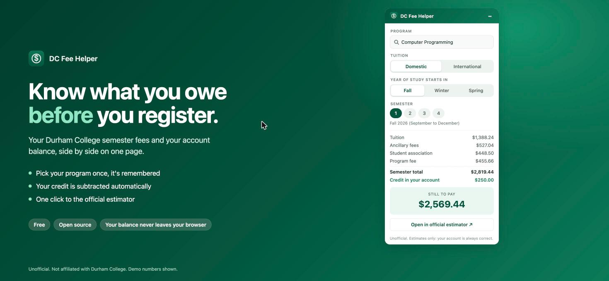
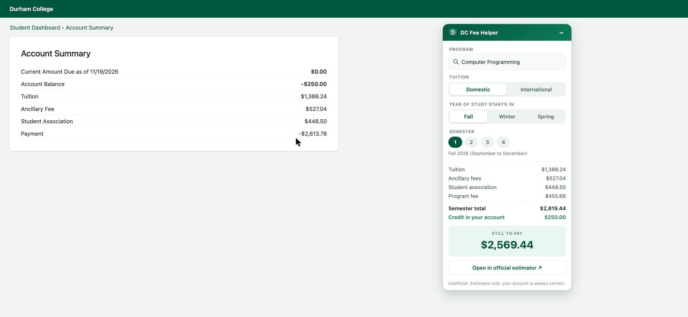

# DC Fee Helper



A free Chrome extension for Durham College students. Open your MyCampus **Account Summary** and see your next semester's estimated fees next to your balance, with the amount **still to pay** worked out for you. No more flipping between the Program Fee Estimator and your account.

> Unofficial. Not affiliated with or endorsed by Durham College. Numbers are estimates; the fees on your account are always the correct ones.



## Install (2 minutes, Chrome / Edge / Brave)

1. **Download** the latest `dc-fee-helper-*.zip` from the [Releases page](https://github.com/pouyashahrdami/dc-fee-helper/releases/latest) and unzip it. Keep the folder somewhere permanent (Chrome loads the extension from it).
2. Open `chrome://extensions` and turn on **Developer mode** (top right).
3. Click **Load unpacked** and choose the unzipped folder.
4. Sign in to MyCampus and open **Account Summary**. The panel appears on the right.

Update: download the new zip, replace the folder contents, then click the refresh icon on the extension card.

## Install with an AI assistant

Using Claude Code, Cursor, Copilot or another AI that can run commands on your computer? Paste this:

```text
Install the "DC Fee Helper" Chrome extension from https://github.com/pouyashahrdami/dc-fee-helper
1. Download the latest release zip (dc-fee-helper-*.zip) from the Releases page into ~/Extensions/dc-fee-helper and unzip it there.
2. Check that manifest.json is directly inside that folder.
3. Don't change any code. Then tell me the exact folder path to choose and the steps to finish in Chrome.
```

Chrome doesn't let programs add extensions silently, so the last part is always yours: open `chrome://extensions`, turn on **Developer mode**, click **Load unpacked** and pick that folder.

## Change the colors (theme) with AI

All colors live in one block at the top of the `CSS` string in `content.js`:

```css
.card { --brand: #00573f; --accent: #0a7a58; --tint: #eaf6f1; --track: #eef3f0; --track-hover: #e0ebe5; ... }
```

Give your AI the folder and a prompt like this (swap in your own colors or school-spirit idea):

```text
In content.js of this Chrome extension, re-theme the panel to navy and gold.
Only change the five color variables at the top of the CSS block (--brand, --accent, --tint, --track, --track-hover).
Keep text readable (good contrast) and don't touch any JavaScript logic or network code.
Then tell me how to reload the extension.
```

After it edits the file, open `chrome://extensions`, click the refresh icon on the extension card, then reload the Account Summary page. Want the logo or layout changed too? Say so in the prompt, but keep the privacy rules in [CONTRIBUTING.md](CONTRIBUTING.md): no tracking and no extra network calls.

## How to use

1. Search and pick your **program**, choose **Domestic** or **International**, and when your year of study starts (**Fall / Winter / Spring**).
2. Pick a **semester**. You get the fee breakdown (tuition, ancillary, student association, program and co-op fees).
3. **Still to pay** is the semester total minus the credit in your account (a negative balance in MyCampus is money left in your account), or plus anything you already owe.
4. **Open in official estimator** jumps to the college's page with your selections.

Your choices are saved for next time. Drag the panel by its green header; use the **–** button to collapse it.

## Privacy

- Your balance is read from the page in your own browser and never leaves it.
- The only network call is to Durham College's public fee data (`durhamcollege.ca/wp-json/dc/v2/programs/fees/`), the same data the official estimator uses.
- Selections are stored locally with `chrome.storage`. No analytics, no accounts. Full policy: [PRIVACY.md](PRIVACY.md).

## Known limits

- Fees are full-time estimates from the official estimator. Part-time loads or extra courses can differ.
- Some programs don't offer every start term; the panel tells you which ones do.
- If the College changes its fee data or the Account Summary layout, the extension may need an update. [Open an issue](https://github.com/pouyashahrdami/dc-fee-helper/issues) if the numbers look wrong.

## Development

```bash
./scripts/pack.sh        # builds dist/dc-fee-helper-<version>.zip
node tests/sweep.mjs     # checks the fee API for every program/term/tuition combination
```

## Contributing

Issues and pull requests are welcome. See [CONTRIBUTING.md](CONTRIBUTING.md). Please never post your real balance or student details.

## License

MIT
